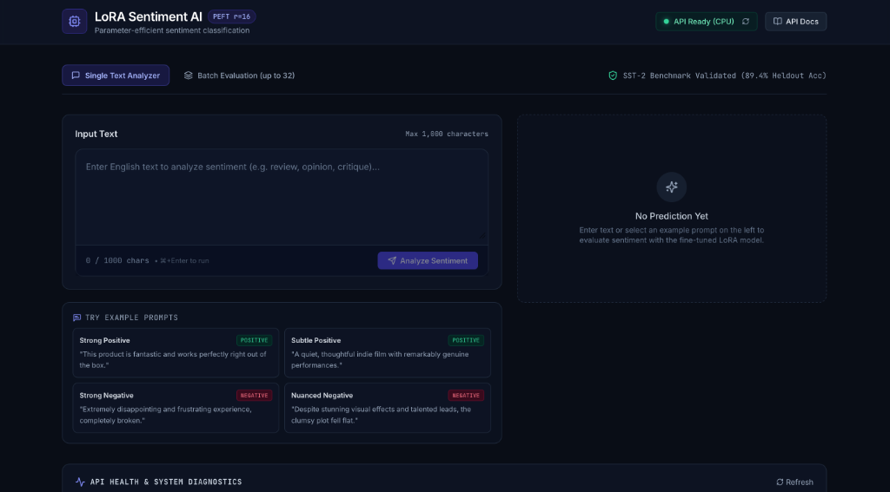
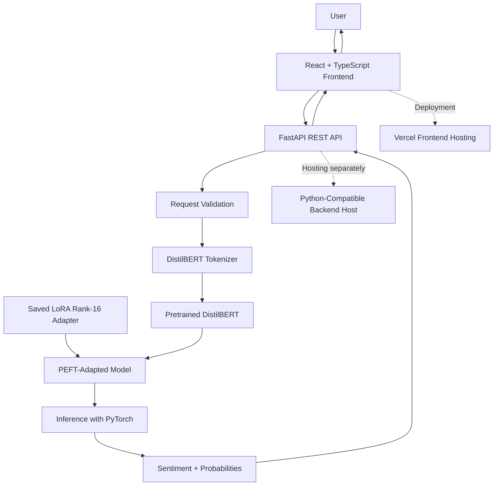

# LoRA Sentiment AI — Parameter-Efficient Sentiment Classification

> Production-style full-stack AI engineering portfolio project featuring a parameter-efficient sentiment analysis service built with DistilBERT, Hugging Face PEFT / LoRA, FastAPI, and a modern React + TypeScript research dashboard.

---

## 1. Project Overview

**LoRA Sentiment AI** is an end-to-end machine learning system demonstrating how to fine-tune, serve, and present parameter-efficient NLP models in production. Rather than fine-tuning all 66 million parameters of a transformer backbone, Low-Rank Adaptation (LoRA) freezes the base model and injects trainable low-rank decomposition matrices into the multi-head attention projection layers (`q_lin` and `v_lin`).

This project pairs a verified rank-16 LoRA adapter with an asynchronous, typed FastAPI inference engine and a minimalist research dashboard crafted in React, TypeScript, and Tailwind CSS.

---

## 2. Features

- **Parameter-Efficient Inference:** Loads frozen `distilbert/distilbert-base-uncased` with fine-tuned LoRA rank-16 adapter matrices and preserved classification head weights (`modules_to_save`).
- **One-Time Startup Lifecycle:** The model and tokenizer load once during server startup using FastAPI's `@asynccontextmanager` lifespan, eliminating per-request cold-start overhead.
- **Hardware-Accelerated Compute:** Automatic device resolution favoring Apple Silicon MPS (Metal Performance Shaders) or CUDA, with seamless CPU fallback.
- **Strict Data Contracts:** Pydantic models enforce non-empty inputs, strip whitespace, and constrain sequence lengths to match training constraints ($\le 128$ tokens).
- **Batch Evaluation:** Dedicated `POST /predict/batch` endpoint supporting up to 32 items evaluated concurrently while strictly maintaining input order.
- **Modern Minimalist UI:** Dark charcoal/navy dashboard built with React 18, Vite, TypeScript, and Tailwind CSS, featuring live character counting, example prompts, probability distribution bars, and real-time backend health diagnostics.
- **Production-Ready Architecture:** Explicit configurable CORS (`FRONTEND_ORIGINS`), SPA-ready routing (`vercel.json`), and clean decoupling of frontend and backend environments.
- **Deterministic Test Coverage:** 20 automated tests validating API health, response schemas, probability ranges ($\sum p \approx 1$), weight immutability across repeated inferences, and edge-case boundary errors (HTTP 422).

---

## 3. Screenshots


*Interactive research dashboard showcasing parameter-efficient sentiment analysis, real-time backend health monitoring (`API Ready (CPU)`), prompt testing, and system diagnostics.*

---

## 4. System Architecture



### Architecture Walkthrough

1. **User Interaction:** The user inputs text through the React + TypeScript frontend or selects an example prompt.
2. **Client Dispatch:** The centralized API service in `frontend/src/services/api.ts` checks boundaries, attaches timeout handlers, and dispatches JSON payloads to the configured `VITE_API_BASE_URL`.
3. **Validation Gate:** FastAPI intercepts requests against strict Pydantic models (`PredictRequest` / `BatchPredictRequest`). Payloads that are blank, whitespace-only, or exceed length limits are rejected with HTTP 422.
4. **Tokenization:** Inputs are tokenized via `AutoTokenizer` loaded from the adapter directory, truncating at a maximum sequence length of 128 tokens.
5. **Adapted Inference:** PyTorch runs forward passes inside `torch.inference_mode()` with `model.eval()`. LoRA rank-16 projection matrices and the preserved `pre_classifier` and `classifier` layers execute on the active compute device (MPS/CUDA/CPU).
6. **Softmax Output:** Raw logits are converted into normalized probabilities via `torch.softmax(dim=-1)`, rounded to configured decimal precision, and returned with model metadata.
7. **Decoupled Hosting:** The frontend compiles into a static single-page application hosted on Vercel, while the Python backend is deployed to a Python-compatible cloud container service (e.g., Render, Railway, AWS ECS).

---

## 5. Technology Stack

### Machine Learning & Backend
- **Language:** Python 3.10+
- **Framework:** FastAPI (`>=0.110.0`)
- **Server:** Uvicorn with uvloop (`uvicorn[standard]`)
- **Deep Learning:** PyTorch (`>=2.2.0`)
- **NLP / Adapters:** Hugging Face `transformers` (`>=4.38.0`), `peft` (`>=0.21.2`), `safetensors`
- **Validation & Settings:** Pydantic v2, `pydantic-settings`
- **Testing:** Pytest (`>=8.0.0`), HTTPX

### Frontend Dashboard
- **Framework:** React 18
- **Language:** TypeScript
- **Build Tool:** Vite 5
- **Styling:** Tailwind CSS 3
- **Icons:** Lucide React
- **Deployment:** Vercel (SPA routing via `vercel.json`)

---

## 6. Research Methodology

This project implements a parameter-efficient fine-tuning study on binary sentiment classification using the **Stanford Sentiment Treebank (SST-2)** dataset:

- **Base Backbone:** `distilbert/distilbert-base-uncased` (6 layers, 768 hidden dimension, 12 attention heads, ~66.3M total parameters).
- **Adaptation Strategy:** LoRA injects trainable rank decomposition matrices into attention linear layers:
  $$W = W_0 + \Delta W = W_0 + \frac{\alpha}{r}(B \cdot A)$$
  where $A \in \mathbb{R}^{r \times d_{in}}$, $B \in \mathbb{R}^{d_{out} \times r}$, $r = 16$, and $\alpha = 32$.
- **Target Modules:** Query (`q_lin`) and Value (`v_lin`) attention projections.
- **Preserved Classification Head:** The linear sequence classification layers (`pre_classifier` $\mathbb{R}^{768 \times 768}$ and `classifier` $\mathbb{R}^{768 \times 2}$) were retained using PEFT `modules_to_save`, storing their fine-tuned weights directly inside `adapter_model.safetensors` alongside adapter weights.
- **Training Constraints:**
  - Max sequence length: 128 tokens
  - Training subset: 5,000 examples
  - Validation subset: 872 examples
  - Separate heldout subset: 1,000 examples sampled from the unused remainder of the original SST-2 training partition

---

## 7. Experimental Results

The table below documents the empirical evaluation progression across baselines, LoRA rank configurations, and repeated multi-seed trials:

| Experiment | Accuracy | Macro F1 |
|---|---:|---:|
| Frozen-backbone baseline, validation | 82.80% | 82.79% |
| LoRA rank 4, validation | 86.01% | 86.00% |
| LoRA rank 8, validation, initial run | 86.70% | 86.69% |
| LoRA rank 16, validation, initial run | 87.96% | 87.95% |
| LoRA rank 8, three-seed mean | 86.96% | 86.95% |
| LoRA rank 16, three-seed mean | 87.38% | 87.37% |
| **LoRA rank 16, separate heldout subset** | **89.40%** | **89.26%** |

### Experimental Notes & Scope Disclosures
- **Multi-Seed Stability:** The rank 8 and rank 16 repeated validation experiments were executed across three independent seeds each, showing stable convergence with low variance.
- **Heldout Partition:** The heldout evaluation subset contains 1,000 examples sampled randomly from the unused remainder of the original SST-2 training partition. It is **not** the official GLUE benchmark test set. Consequently, the 89.40% accuracy and 89.26% macro F1 results should be interpreted as evaluation on that specific heldout subset, and not directly compared to validation results or leaderboard test scores.
- **Study Classification:** This work is a **LoRA reproduction study and engineering implementation**, not an exact replication of the original paper (*Hu et al., 2021*).

---

## 8. Installation & Local Development

### Repository Structure

```text
LORA REPRODUCTION/
├── app/                      # FastAPI service application
│   ├── __init__.py
│   ├── config.py             # Pydantic Settings & device resolution
│   ├── main.py               # FastAPI app, lifespan handler, CORS, endpoints
│   ├── model_service.py      # PEFT adapter loader & inference engine
│   └── schemas.py            # Pydantic request/response models
├── Models/
│   └── lora-sst2-adapter/    # LoRA weights & tokenizer configuration
│       ├── adapter_config.json
│       ├── adapter_model.safetensors
│       ├── tokenizer_config.json
│       ├── tokenizer.json
│       └── README.md
├── frontend/                 # React + TypeScript dashboard
│   ├── src/
│   │   ├── components/       # UI components (Header, Input, Results, Batch, Diagnostics)
│   │   ├── services/api.ts   # Centralized typed HTTP client
│   │   ├── types/api.ts      # TypeScript interfaces matching backend schemas
│   │   ├── App.tsx
│   │   ├── main.tsx
│   │   └── index.css
│   ├── package.json
│   ├── tsconfig.json
│   ├── tailwind.config.js
│   ├── vite.config.ts
│   └── vercel.json           # Vercel SPA deployment configuration
├── tests/                    # Pytest test suite
│   ├── conftest.py
│   ├── test_health.py
│   ├── test_predict.py
│   └── test_validation.py
├── requirements.txt          # Python dependencies
├── .env.example              # Backend environment template
├── .gitignore
└── README.md
```

### Step 1: Clone and Setup Virtual Environment

```bash
cd "LORA REPRODUCTION"

# Create Python virtual environment
python3 -m venv .venv
source .venv/bin/activate

# Upgrade pip and install backend dependencies
python -m pip install --upgrade pip
pip install -r requirements.txt
```

### Step 2: Install Frontend Dependencies

```bash
cd frontend
npm install
cd ..
```

---

## 9. FastAPI Configuration and Startup

### Environment Variables (`.env`)

Copy `.env.example` to create your local backend configuration:

```bash
cp .env.example .env
```

Key environment options:
```dotenv
APP_NAME="DistilBERT LoRA Sentiment Classification API"
APP_VERSION="1.0.0"
HOST=127.0.0.1
PORT=8000

BASE_MODEL_NAME_OR_PATH="distilbert/distilbert-base-uncased"
ADAPTER_PATH="Models/lora-sst2-adapter"

# Device: "auto" selects MPS (Apple Silicon), CUDA (NVIDIA), or CPU
DEVICE="auto"

# Allowed CORS origins (comma-separated)
FRONTEND_ORIGINS="http://localhost:5173,http://127.0.0.1:5173,http://localhost:3000"

MAX_SEQUENCE_LENGTH=128
EXPECTED_LORA_RANK=16
DECIMAL_PRECISION=4
MAX_BATCH_SIZE=32
MAX_INPUT_CHAR_LENGTH=1000
```

### Starting the API Server

```bash
source .venv/bin/activate
uvicorn app.main:app --reload --host 127.0.0.1 --port 8000
```

The server initializes the model and tokenizer during lifespan startup. Once ready, access:
- **Service Root:** [http://127.0.0.1:8000/](http://127.0.0.1:8000/)
- **Health Check:** [http://127.0.0.1:8000/health](http://127.0.0.1:8000/health)
- **Interactive OpenAPI Documentation:** [http://127.0.0.1:8000/docs](http://127.0.0.1:8000/docs)
- **ReDoc Documentation:** [http://127.0.0.1:8000/redoc](http://127.0.0.1:8000/redoc)

---

## 10. Frontend Configuration and Startup

### Environment Variables (`frontend/.env`)

Create `frontend/.env` to point to the backend:

```bash
cd frontend
cp .env.example .env
```

Contents of `frontend/.env`:
```dotenv
VITE_API_BASE_URL=http://127.0.0.1:8000
```

> **Security Note:** Variables prefixed with `VITE_` are embedded into the client bundle at build time. Never store private API keys, database credentials, or secret tokens in frontend environment files.

### Starting the Development Server

```bash
cd frontend
npm run dev
```

The frontend dashboard will be available at [http://localhost:5173](http://localhost:5173).

---

## 11. API Endpoints with Examples

### `GET /` — Service Metadata

```bash
curl -s http://127.0.0.1:8000/ | python3 -m json.tool
```

**Response (HTTP 200 OK):**
```json
{
  "name": "DistilBERT LoRA Sentiment Classification API",
  "version": "1.0.0",
  "task": "Binary sentiment classification using SST-2 (0=negative, 1=positive)",
  "endpoints": {
    "/": "GET - Service metadata and discovery",
    "/health": "GET - Readiness and health diagnostics",
    "/predict": "POST - Single-text sentiment classification",
    "/predict/batch": "POST - Batch sentiment classification (up to 32 texts)",
    "/docs": "GET - Interactive OpenAPI Swagger UI",
    "/redoc": "GET - ReDoc API documentation"
  }
}
```

---

### `GET /health` — Readiness Check

```bash
curl -s http://127.0.0.1:8000/health | python3 -m json.tool
```

**Response (HTTP 200 OK when ready):**
```json
{
  "status": "ready",
  "model_loaded": true,
  "device": "mps",
  "base_model": "distilbert/distilbert-base-uncased",
  "adapter_path": "Models/lora-sst2-adapter",
  "lora_rank": 16,
  "details": "Service is fully initialized, evaluation mode active."
}
```

*Note: Returns HTTP 503 if the model failed to initialize or adapter files are missing.*

---

### `POST /predict` — Single Sentiment Prediction

```bash
curl -s -X POST http://127.0.0.1:8000/predict \
  -H "Content-Type: application/json" \
  -d '{"text": "This product is fantastic and works perfectly."}' | python3 -m json.tool
```

**Response (HTTP 200 OK):**
```json
{
  "text": "This product is fantastic and works perfectly.",
  "sentiment": "positive",
  "confidence": 0.9992,
  "probabilities": {
    "negative": 0.0008,
    "positive": 0.9992
  },
  "model": "distilbert/distilbert-base-uncased",
  "adapter": "LoRA",
  "rank": 16
}
```

---

### `POST /predict/batch` — Batch Prediction (Up to 32 Items)

```bash
curl -s -X POST http://127.0.0.1:8000/predict/batch \
  -H "Content-Type: application/json" \
  -d '{
    "texts": [
      "Truly wonderful and delightful storytelling!",
      "Terrible quality, completely broke after one use."
    ]
  }' | python3 -m json.tool
```

**Response (HTTP 200 OK):**
```json
{
  "predictions": [
    {
      "text": "Truly wonderful and delightful storytelling!",
      "sentiment": "positive",
      "confidence": 0.9998,
      "probabilities": {
        "negative": 0.0002,
        "positive": 0.9998
      },
      "model": "distilbert/distilbert-base-uncased",
      "adapter": "LoRA",
      "rank": 16
    },
    {
      "text": "Terrible quality, completely broke after one use.",
      "sentiment": "negative",
      "confidence": 0.9879,
      "probabilities": {
        "negative": 0.9879,
        "positive": 0.0121
      },
      "model": "distilbert/distilbert-base-uncased",
      "adapter": "LoRA",
      "rank": 16
    }
  ],
  "count": 2
}
```

---

## 12. Automated Testing

The project includes automated tests separated across API diagnostics, real model inference, and lightweight boundary validation:

```bash
# Run the full test suite
source .venv/bin/activate
pytest -v
```

### Actual Executed Test Results

```text
============================= test session starts ==============================
platform darwin -- Python 3.10.18 / Python 3.14, pytest-9.1.1
rootdir: /Users/darshanr/Downloads/LORA REPRODUCTION
plugins: anyio-4.15.1
collected 20 items

tests/test_health.py::test_root_endpoint PASSED                          [  5%]
tests/test_health.py::test_health_endpoint_when_ready PASSED             [ 10%]
tests/test_health.py::test_health_endpoint_when_not_ready PASSED         [ 15%]
tests/test_health.py::test_device_resolution_fallback PASSED             [ 20%]
tests/test_predict.py::test_predict_positive_sentiment PASSED            [ 25%]
tests/test_predict.py::test_predict_negative_sentiment PASSED            [ 30%]
tests/test_predict.py::test_batch_prediction_order_and_parity PASSED     [ 35%]
tests/test_predict.py::test_repeated_inference_does_not_modify_weights PASSED [ 40%]
tests/test_validation.py::test_empty_text_returns_422 PASSED             [ 45%]
tests/test_validation.py::test_whitespace_text_returns_422 PASSED        [ 50%]
tests/test_validation.py::test_excessive_length_text_returns_422 PASSED  [ 55%]
tests/test_validation.py::test_missing_text_field_returns_422 PASSED     [ 60%]
tests/test_validation.py::test_extra_fields_forbidden_returns_422 PASSED [ 65%]
tests/test_validation.py::test_batch_empty_list_returns_422 PASSED       [ 70%]
tests/test_validation.py::test_batch_exceeding_max_items_returns_422 PASSED [ 75%]
tests/test_validation.py::test_batch_with_whitespace_item_returns_422 PASSED [ 80%]
tests/test_validation.py::test_adapter_missing_directory_raises_clear_error PASSED [ 85%]
tests/test_validation.py::test_adapter_missing_config_raises_clear_error PASSED [ 90%]
tests/test_validation.py::test_adapter_missing_weights_raises_clear_error PASSED [ 95%]
tests/test_validation.py::test_adapter_rank_mismatch_raises_clear_error PASSED [100%]

============================== 20 passed in 2.69s ==============================
```

### Frontend Typecheck & Build

```bash
cd frontend
npm run build
```

**Actual Output:**
```text
> lora-sentiment-frontend@1.0.0 build
> tsc && vite build

vite v5.4.21 building for production...
✓ 1584 modules transformed.
dist/index.html                   1.09 kB │ gzip:  0.61 kB
dist/assets/index-DGMgX75h.css   22.43 kB │ gzip:  4.82 kB
dist/assets/index-BwEdR3AK.js   181.58 kB │ gzip: 55.13 kB
✓ built in 885ms
```

---

## 13. Vercel Deployment Guide

To deploy the **LoRA Sentiment AI** frontend dashboard on Vercel:

### Step 1: Push Code to GitHub / GitLab / Bitbucket
Ensure your repository contains the root directory with the `frontend/` folder.

### Step 2: Import into Vercel
1. Log in to your [Vercel Dashboard](https://vercel.com).
2. Click **Add New...** > **Project** and select your repository.
3. In **Root Directory**, click **Edit** and select `frontend`.
4. Ensure the framework preset is detected as **Vite**.
5. Build settings will automatically populate:
   - Build Command: `npm run build`
   - Output Directory: `dist`

### Step 3: Configure Environment Variables
In the Vercel **Environment Variables** panel, add:
- **Key:** `VITE_API_BASE_URL`
- **Value:** Your live publicly accessible backend service URL (e.g., `https://api.your-sentiment-backend.com`).
- *Important:* Never use `http://127.0.0.1:8000` or `http://localhost:8000` as the production URL on Vercel.

### Step 4: Deploy
Click **Deploy**. Vercel will compile the TypeScript application, optimize assets, and deploy the application to a high-speed global edge network. SPA client-side routing is automatically handled via `frontend/vercel.json`.

---

## 14. CORS & Production Backend Hosting

Because the frontend is hosted statically on Vercel and the FastAPI service runs on a dedicated Python host (e.g., Render, Railway, AWS ECS, GCP Cloud Run), cross-origin requests must be explicitly permitted.

1. **Configure Backend Allowed Origins:**
   On your backend hosting platform, set the environment variable:
   ```bash
   FRONTEND_ORIGINS="https://your-project.vercel.app,http://localhost:5173"
   ```
2. **Security Best Practice:**
   FastAPI's `CORSMiddleware` in `app/main.py` explicitly parses `FRONTEND_ORIGINS`. It does **not** allow wildcard `*` with credentials, preventing cross-origin security vulnerabilities.
3. **Updating Backend URLs:**
   When your backend host URL changes, update `VITE_API_BASE_URL` in your Vercel Project Settings under **Settings > Environment Variables**, and trigger a redeployment.

---

## 15. Limitations

- **Binary Classification Scope:** The model was fine-tuned on the binary SST-2 benchmark (0=negative, 1=positive). It does not contain an explicit neutral, mixed, or sarcasm class.
- **Softmax Score Interpretation:** Softmax outputs represent uncalibrated relative class weights rather than Bayesian posterior certainty. High confidence scores on out-of-domain text should not be mistaken for verified factual certainty.
- **Sequence Length Truncation:** Tokens beyond sequence length 128 are truncated, which may omit context in long articles or long-form essays.
- **Dataset Partition Boundary:** The 89.4% accuracy was measured on the specific 1,000-example heldout subset sampled from the training partition; performance may vary on wild, uncurated social media text.

---

## 16. Troubleshooting

| Symptom | Cause | Solution |
| :--- | :--- | :--- |
| **CORS Blocked in Browser Console** | Backend does not include Vercel domain in allowed origins | Add your frontend Vercel URL to `FRONTEND_ORIGINS` in the backend environment. |
| **API Status "Offline" in Dashboard** | `VITE_API_BASE_URL` incorrect or backend down | Verify that the backend URL is reachable via `GET /health` in a browser or curl. |
| **HTTP 503 Service Unavailable** | Adapter files missing or corrupted | Verify `Models/lora-sst2-adapter/` contains `adapter_config.json` and `adapter_model.safetensors`. |
| **HTTP 422 Unprocessable Entity** | Input blank, whitespace, or exceeding 1,000 chars | Provide valid text between 1 and 1,000 characters. |
| **Backend port conflict on 8000** | Port 8000 already occupied by another service | Launch with `--port 8001` and update `VITE_API_BASE_URL=http://127.0.0.1:8001`. |

---

## 17. Future Improvements

- **Quantized Inference:** Implement bitsandbytes 4-bit / 8-bit NF4 quantization for low-memory edge deployments.
- **ONNX Runtime Export:** Export the PEFT adapter merged into DistilBERT for accelerated cross-platform ONNX inference.
- **Streaming Token Classification:** Expand interface to show token-level attribution or attention saliency heatmaps using Integrated Gradients.
- **Multi-Class Sentiment:** Fine-tune LoRA on 5-class SST (very negative, negative, neutral, positive, very positive).

---

## 18. References

1. **LoRA Paper:** Hu, E. J., Shen, Y., Wallis, P., Allen-Zhu, Z., Li, Y., Wang, S., Wang, L., & Chen, W. (2021). *LoRA: Low-Rank Adaptation of Large Language Models*. [arXiv:2106.09685](https://arxiv.org/abs/2106.09685).
2. **DistilBERT Paper:** Sanh, V., Debut, L., Chaumond, J., & Wolf, T. (2019). *DistilBERT, a distilled version of BERT: smaller, faster, cheaper and lighter*. [arXiv:1910.01108](https://arxiv.org/abs/1910.01108).
3. **Hugging Face PEFT Documentation:** [https://huggingface.co/docs/peft/](https://huggingface.co/docs/peft/)
4. **FastAPI Documentation:** [https://fastapi.tiangolo.com/](https://fastapi.tiangolo.com/)
5. **Vite Documentation:** [https://vitejs.dev/](https://vitejs.dev/)
